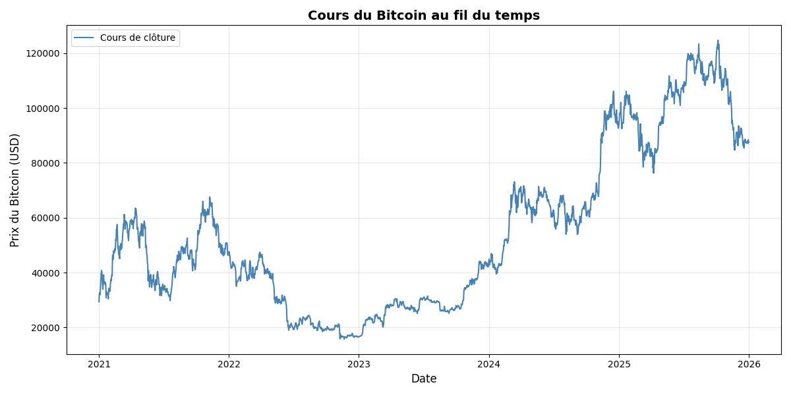
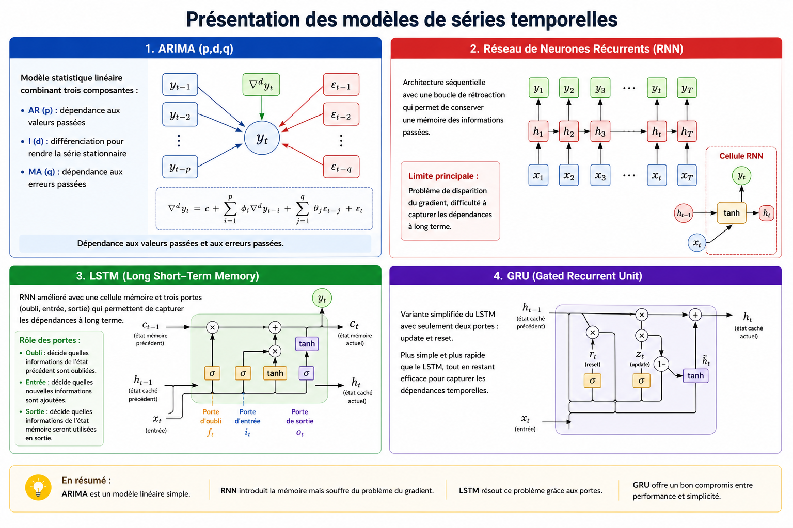
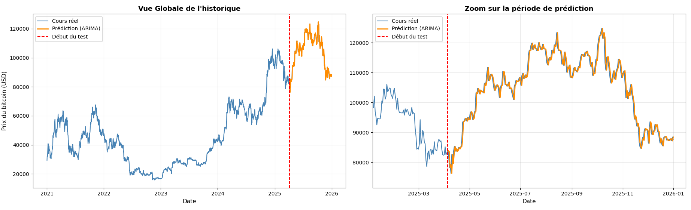
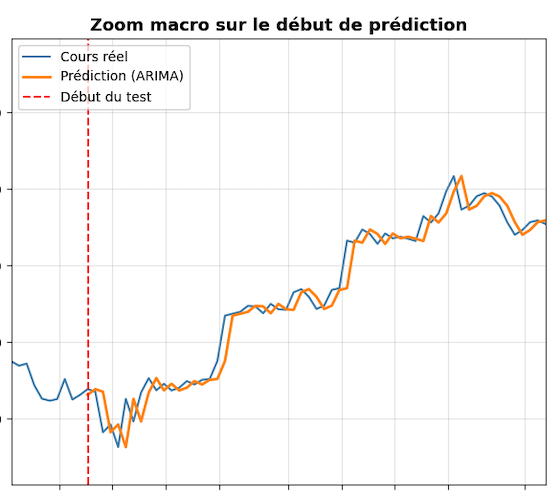
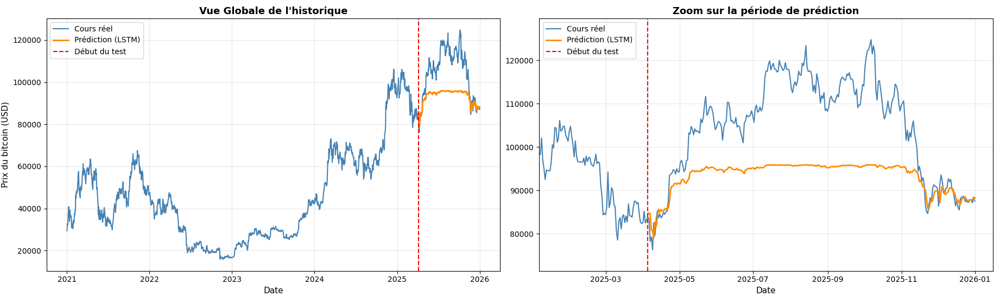
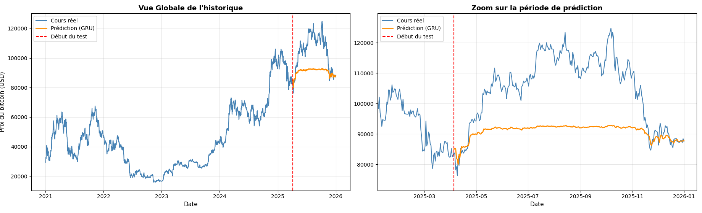

# Prévision du prix du Bitcoin : ARIMA, LSTM, GRU et analyse de sentiment

**Mémoire de Licence 3 MIASHS – Université de Bordeaux (2026)**
*« Web Scraping, récolte et analyse de données »*

Projet réalisé en équipe de 3 : Alric Poupon, Nolan Thaunay, Princesse Mahoungou – encadré par Adrien Orué

---

## 🎯 Problématique

Le Bitcoin est un actif très volatil, sans valeur garantie par un État. **Dans quelle mesure des modèles de séries temporelles permettent-ils de prévoir à court terme son prix journalier ?**

Nous comparons un modèle statistique classique (**ARIMA**) à deux réseaux de neurones récurrents (**LSTM** et **GRU**). Nous testons ensuite l'apport d'un **score de sentiment** extrait des réseaux sociaux.

## 📦 Données

| Source | Collecte | Contenu |
|---|---|---|
| Yahoo Finance | Python, bibliothèque `yfinance` | Prix journaliers du 01/01/2021 au 01/01/2026 (~1 500 observations) : Open, High, Low, Close, Volume |
| Reddit | API publique (endpoints `.json`) | Commentaires les plus votés de r/Bitcoin et r/CryptoCurrency sur 30 jours, enregistrés dans un CSV |

- **Découpage chronologique** pour éviter toute fuite de données du futur vers le passé : 70 % entraînement / validation, 30 % test hors échantillon.
- **Collecte responsable** : respect des conditions d'utilisation et du `robots.txt`, pas de surcharge des serveurs, attention au RGPD.

## 🧠 Méthode

### Modèles de séries temporelles

- **ARIMA** : paramètres choisis par le critère AIC → ARIMA(0,1,0), avec une prévision glissante à un pas (*1-step ahead rolling forecast*).
- **LSTM et GRU** : fenêtre glissante des 15 derniers jours (Open, High, Low, Volume, Close) pour prédire le prix de clôture du lendemain.
- **Évaluation** : RMSE, MAE et MAPE sur le jeu de test.
- **Sentiment** : chaque commentaire Reddit est noté avec **FinBERT** (Hugging Face) selon `score = P(positif) − P(négatif)`, puis agrégé par jour en moyenne pondérée par les upvotes.

## 📊 Résultats

| Modèle | MAE (USD) | RMSE (USD) | MAPE (%) |
|---|---:|---:|---:|
| ARIMA(0,1,0) | 1 482,98 | 2 011,29 | **1,44** |
| LSTM | 11 725,86 | 14 091,80 | 10,53 |
| GRU | 14 101,32 | 16 673,28 | 12,69 |

### ⚠️ Le résultat le plus intéressant : un 1,44 % trompeur

À première vue, ARIMA semble presque parfait. Mais un zoom montre que la courbe prédite est simplement **décalée d'un jour** :

ARIMA(0,1,0) correspond à une **marche aléatoire** : `Y(t) = Y(t-1) + ε(t)`. Le modèle ne prévoit rien, il recopie le prix de la veille.
> Une bonne métrique ne suffit pas : il faut toujours comparer à une référence naïve et regarder les prédictions.

### LSTM et GRU : un plafond

Entraînés sur des prix compris surtout entre 20 000 $ et 80 000 $, les réseaux de neurones **plafonnent autour de 90 000 $** et ne suivent pas la hausse au-delà de 100 000 $.

| LSTM | GRU |
|---|---|
|  |  |

### Sentiment Reddit

Les scores journaliers ont bien été calculés, mais 30 jours de données sont trop peu face à 5 ans de prix pour entraîner un modèle commun. La piste reste ouverte.

## 💡 Conclusions

- Avec seulement l'historique des prix, **le meilleur prédicteur du prix de demain est le prix d'aujourd'hui** : le passé contient très peu d'information utile.
- **Une erreur faible peut cacher un modèle inutile** : il faut évaluer les sorties, pas seulement les chiffres.
- **Pistes d'amélioration** : prédire les rendements plutôt que les prix bruts ; collecter le sentiment sur 1 à 2 ans ; ajouter des variables externes.

## 🗂️ Contenu du dépôt

- [`Mémoire web scraping .pdf`](Me%CC%81moire%20web%20scraping%20.pdf) : le mémoire complet (26 pages)
- Fichiers `.png` : les figures et résultats du mémoire

## 👩‍💻 Ma contribution

Projet réalisé en équipe de 3. J'ai participé à la **rédaction du mémoire**, à l'**analyse et à l'interprétation des résultats**, ainsi qu'à la **soutenance orale**. Le code de collecte et de modélisation a été principalement développé par un coéquipier.

## 🛠️ Technologies

Python · yfinance · pandas · statsmodels (ARIMA) · réseaux récurrents (LSTM, GRU) · FinBERT (Hugging Face) · API Reddit · matplotlib
